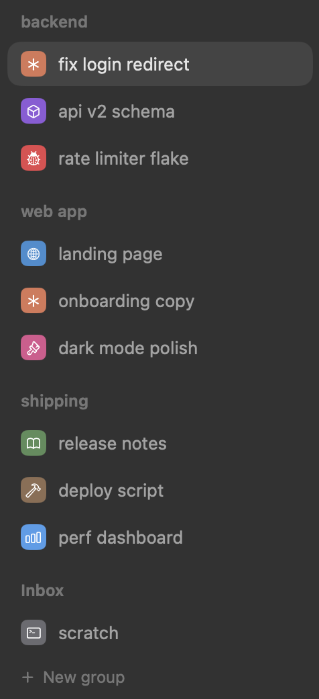
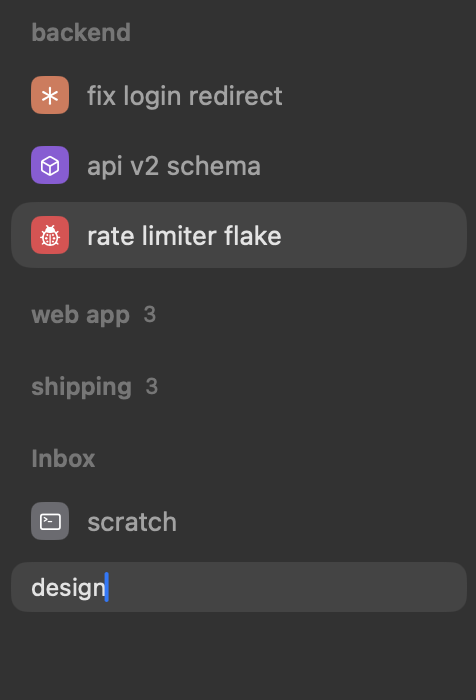
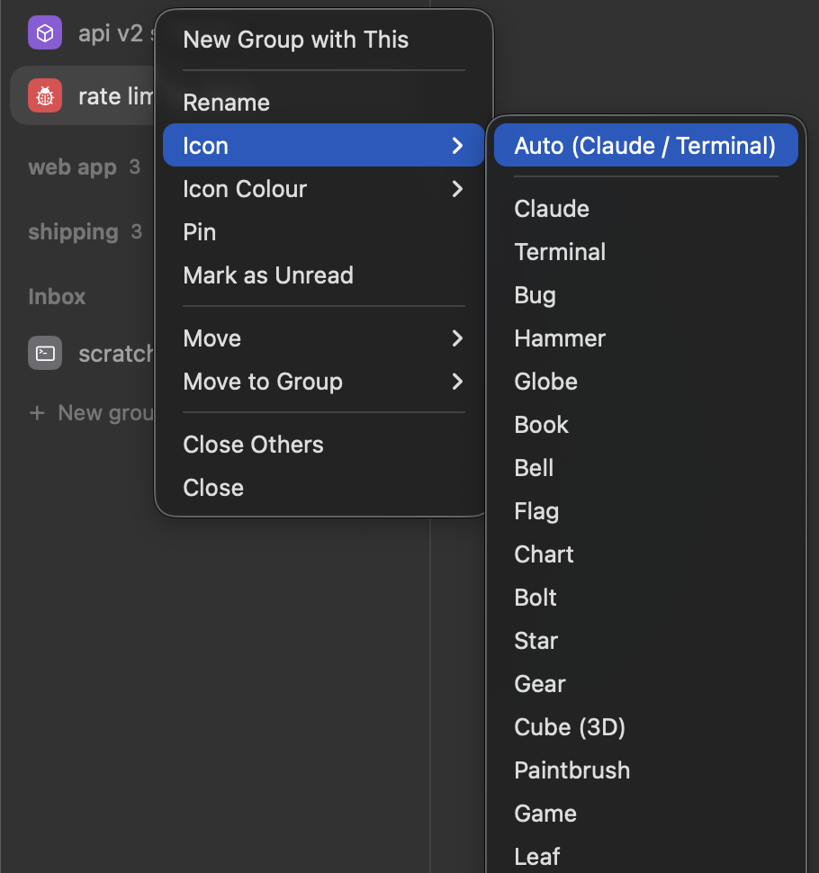

# cmux-setup

A clean, Rex-style sidebar for [cmux](https://cmux.com): every tab lives in a collapsible group, with icons and a "working" indicator for Claude. Also sets the terminal font to SF Mono.



## Install

```sh
git clone https://github.com/byronwang93/cmux-setup && cd cmux-setup && ./install.sh
```

Needs cmux 0.65 or newer, run from `/Applications`; the installer warns if either isn't the case. It backs up anything it changes. To update later, run `git pull && ./install.sh`.

## What it does

**Groups.** Click **＋ New group**, type a name and press Return. Hover a group label for **⊕** (new tab in the group) and the chevron (collapse).

**Drag and drop.** Drag tabs from one group to another, or drag a group's label to move the whole group.



**Every tab is in a group.** New tabs join the group you're in. Anything left loose goes to **Inbox**.

**Icons.** Right-click a tab → **Icon** / **Icon Colour**. *Auto* shows the Claude tile while Claude is running, and a terminal otherwise.



**Working dots.** Three dots appear on a tab while Claude is mid-turn in it.

## Files

| File | Installs to |
|---|---|
| `sidebars/clean.js` | `~/.config/cmux/sidebars/clean.js` |
| `ghostty/config` | added as a block at the end of `~/.config/ghostty/config`, keeping your existing settings |
